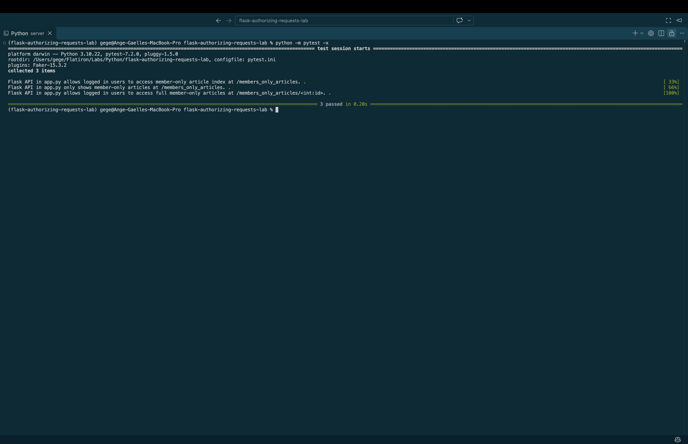

# Flask Authorizing Requests Lab

## Overview

This lab demonstrates how to implement request authorization in a Flask REST API using session-based authentication.

The application restricts access to members-only articles by checking whether a user is logged in before returning protected resources.

This lab builds upon previous concepts involving cookies, sessions, and user authentication.

## Learning Objectives

- Understand the difference between authentication and authorization.
- Use Flask sessions to identify logged-in users.
- Restrict access to protected API endpoints.
- Filter database records using SQLAlchemy.
- Serialize database records using Marshmallow.
- Return appropriate HTTP status codes and error messages.
- Test authorization logic using Pytest.

## Technologies Used

- Python 3.10
- Flask
- Flask-RESTful
- Flask-SQLAlchemy
- Flask-Migrate
- Marshmallow
- SQLite
- React
- Faker
- Pytest
- Pipenv

## Getting Started

### 1. Clone the Repository

```bash
git clone https://github.com/a-gbatie/flask-authorizing-requests-lab.git
cd flask-authorizing-requests-lab
```

### 2. Install Backend Dependencies

```bash
pipenv install --python 3.10
pipenv shell
```

Verify the Python version:

```bash
python --version
```

### 3. Install Frontend Dependencies

```bash
npm install --prefix client
```

### 4. Set Up the Database

Navigate to the server directory:

```bash
cd server
```

Apply database migrations:

```bash
flask db upgrade
```

Seed the database:

```bash
python seed.py
```

The seed file creates:

- 25 users with unique usernames.
- 100 articles with randomly generated content.
- A mixture of public and members-only articles.

## Running the Application

### Start the Flask Backend

From the `server` directory:

```bash
python app.py
```

The backend runs at:

http://localhost:5555

### Start the React Frontend

Open a separate terminal from the project root:

```bash
npm start --prefix client
```

The frontend runs at:

http://localhost:3000

## API Endpoints

| Method | Endpoint | Description |
|--------|----------|-------------|
| GET | `/articles` | Retrieve articles |
| GET | `/articles/<int:id>` | Retrieve an individual article |
| POST | `/login` | Log in a user |
| DELETE | `/logout` | Log out a user |
| GET | `/check_session` | Check the current user session |
| DELETE | `/clear` | Reset session data |
| GET | `/members_only_articles` | Retrieve members-only articles for logged-in users |
| GET | `/members_only_articles/<int:id>` | Retrieve an individual article through an authorized endpoint |

## Implementation

### Session-Based Authorization

The application uses Flask's `session` object to determine whether a user is logged in.

```python
user_id = session.get('user_id')
```

If a user is not logged in, the protected endpoint returns:

```python
return {'message': 'Unauthorized'}, 401
```

### Members-Only Article Index

The `MemberOnlyIndex` resource:

- Checks whether the user is logged in.
- Returns a 401 Unauthorized response if no user session exists.
- Filters articles using the `is_member_only` attribute.
- Serializes and returns members-only articles for authorized users.

### Individual Article Authorization

The `MemberOnlyArticle` resource:

- Checks the current user session.
- Rejects unauthorized requests.
- Retrieves an article by its ID.
- Returns a 404 response if the article does not exist.
- Serializes and returns the requested article for authorized users.

### Database Filtering

SQLAlchemy is used to retrieve specific database records.

Filter members-only articles:

```python
Article.query.filter(Article.is_member_only == True).all()
```

Retrieve an individual article:

```python
Article.query.filter(Article.id == id).first()
```

## HTTP Status Codes

| Status Code | Meaning |
|-------------|---------|
| 200 | OK |
| 204 | No Content |
| 401 | Unauthorized |
| 404 | Not Found |

## Running Tests

Activate the Pipenv environment:

```bash
pipenv shell
```

Run the automated test suite:

```bash
python -m pytest -x
```

## Screenshot of Completed tests
